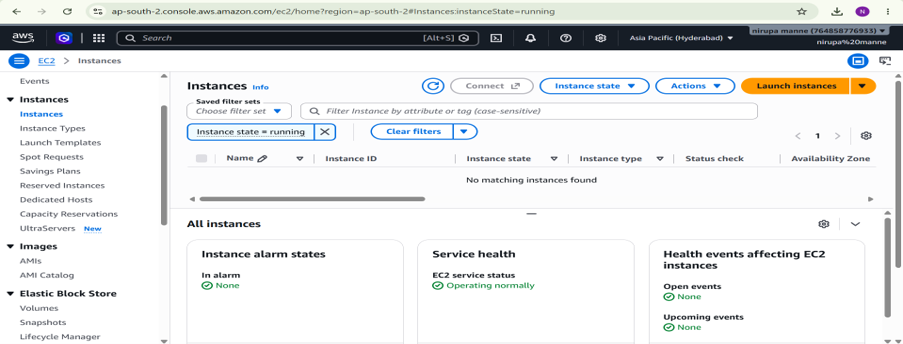

## Assignment — Linux and SSH Setup
1.	Launch an Amazon Linux 2023 EC2 instance in HYD region. Generate an SSH key pair. What is the difference between the two files created?
2.	Connect to your EC2 instance using SSH. Confirm you are connected by checking the hostname, current directory, and logged-in username.
3.	Your Security Group currently allows SSH from anywhere. Restrict it to your own IP only.
4.	Find out which Linux distribution and version is running on the instance.
5.	Delete the instance, Security Group, and key pair.

**1. Launch an Amazon Linux 2023 EC2 instance in HYD region. Generate an SSH key pair. What is the difference between the two files created?**

#### Enable the Hyderabad region 
*Step 1:* Open AWS Console
1. Open AWS Management Console.
2. Log in to your AWS account.
3. On the top-right corner, select the AWS Region.
4. Select Asia Pacific (Hyderabad) – ap-south-2.
5. Search for EC2 in the AWS search bar.
6. Open EC2.
7. Click Launch instance.

#### Generate the key pair (on my laptop)
*Step-2:*
1. Click Create new key pair.
2. Key pair name: linux-assignment-key
3. Key pair type: RSA.
4. Private key file format: .pem.
5. Click Create key pair

*Step-3:* Create a new security group.
Security Group name: linux-ssh-sg, Inbound type: SSH, Protocol: TCP, Port: 22, Source: Anywhere-IPv4 (0.0.0.0/0) – click on create it.

### Import the key and Launch the EC2 Instance
*Step-4:* Launch the EC2 instance and choose Name: Linux ,AMI: Amazon Linux 2023 AMI, Instance type: t3.micro, and select keypair: linux-ssh-key, security existing group: select the group(linux-ssh-sg) -> Click on Launch instance.

***What is the difference?***
- **Private key**: Used by you to prove your identity when connecting to the EC2 instance. Never share it.
- **Public key**: Installed on the EC2 instance. SSH uses it to verify that you have the matching private key.

**2.	Connect to your EC2 instance using SSH. Confirm you are connected by checking the hostname, current directory, and logged-in username.**

Open EC2 → Instances, Select linux Copy its Public IPv4 address.
Open Git Bash and navigate to the folder where the .pem file was downloaded. Then connect the ec2-instance.
ssh -i linux-ssh-key.pem ec2-user@YOUR_PUBLIC_IP
Ex: ssh -i linux-ssh-key.pem ec2-user@3.110.20.50

**Verify the connection: **
hostname
pwd
whoami

**3.	Your Security Group currently allows SSH from anywhere. Restrict it to your own IP only.**
Go to EC2 → Instances, ->Click the linked Security Group name.Open Inbound rules → Edit inbound rules. Find the SSH rule on port 22. ->Change its source from Anywhere-IPv4 (0.0.0.0/0) to My IP-> Click Save rules.

**4.	Find out which Linux distribution and version is running on the instance.**
Connect to your EC2 instance using SSH.
cat /etc/os-release
This displays the Linux kernel version
This displays the distribution's release information: cat /etc/system-release
uname -r

**5.	Delete the EC2 instance, Security Group, and key pair**
Terminate the EC2 instance and delete the security group and key-par.

## Nirupa Manne
